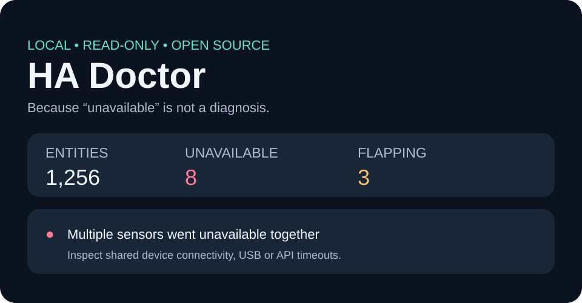

<div align="center">

# 🩺 HA Doctor

**Because “unavailable” is not a diagnosis.**

**A local, read-only Home Assistant troubleshooting tool.**

[Quick start](#quick-start) · [What it checks](#what-it-checks) · [Security](#security) · [Roadmap](#roadmap)

</div>

---



**HA Doctor** helps Home Assistant users diagnose state outages without manually scrolling through thousands of entities or digging through the entire error log.

- 🔴 **Unavailable entity scan:** See the exact list of entities affected.
- ⚡ **Simultaneous outages:** Catch three or more entities going unavailable in the **same polling interval** — useful when an integration briefly loses connectivity.
- 🔁 **Flapping detection:** Observe entities going unavailable and recovering while the doctor watches.
- ⏱ **Stale data checks:** Opt in to expected reporting intervals for specific entities. Uses **`last_reported`**, not `last_changed`.
- 🧠 **Guided next steps:** Recommendations for common log patterns (integration setup, blocked event loop, rate limits, recorder, networking).
- 🌐 **Interactive offline HTML report:** Open in any browser. No cloud dashboard, external scripts, trackers or external libraries.
- 🔒 **Read only by design:** Only HTTP GET; never writes states, calls HA services, restarts anything or changes configurations.
- 🪶 **Runs anywhere with Python 3.10+:** macOS, Linux, Windows, a Raspberry Pi or a machine that can reach Home Assistant.

> **v0.1.0 / MVP:** This is an **external CLI**, not a HACS integration or a native Home Assistant dashboard. It reports symptoms and plausible next steps, **not guaranteed root causes**. Home Assistant already has per-integration diagnostics downloads; HA Doctor complements rather than replaces them.

## Quick start

### 1. Get Python 3.10 or newer

Download/extract this repository and open a terminal inside the folder. You can run directly without installing dependencies:

```bash
python3 -m ha_doctor --demo --html demo.html
```

Open `demo.html` for a completely offline preview with **synthetic example data**.

### 2. Generate a Home Assistant access token

Open your Home Assistant **Profile** → **Long-Lived Access Tokens** → Create token. Store it privately. **Do not post the token in a GitHub issue, screenshot or chat.**

### 3. Connect to your own Home Assistant

macOS / Linux:

```bash
export HA_URL="http://homeassistant.local:8123"
python3 -m ha_doctor --html report.html
```

Windows PowerShell:

```powershell
$env:HA_URL = 'http://homeassistant.local:8123'
py -m ha_doctor --html report.html
```

When prompted, enter your access token (the input is hidden). For unattended jobs, you can instead set `HA_TOKEN` as an environment variable. Open the generated **`report.html`** in your browser. The tool uses the same address and access method as your browser (local network, VPN, etc.). If mDNS doesn't work, use your HA IP address or your configured HTTPS hostname.

You can alternatively install the command (`pip install .`) and run `ha-doctor` instead of `python3 -m ha_doctor`.

## The useful checks

### Catch entities that flicker unavailable

```bash
python3 -m ha_doctor --observe 60 --interval 5 --html report.html
```

Takes one initial snapshot, then polls for 60 seconds. HA Doctor can report simultaneous failures and recoveries, including devices that **look fine** when you open the States screen after the incident.

**Limitations:** Polling can miss outages shorter than the polling interval. The tool does not claim that all entities going offline together share the same integration; an internet outage could affect several integrations at once.

### Find sensors that stopped updating

```bash
python3 -m ha_doctor \
  --stale 'sensor.ouman_*' \
  --stale 'sensor.heatpump_*' \
  --stale-hours 1 \
  --html report.html
```

The staleness check is **opt in** because not all sensors are expected to report periodically. `last_changed` means the value changed. It is *not* evidence that a sensor is dead. `last_reported` means HA received a state write, although device/reporting semantics can vary. If the timestamp is not available from the API, the tool says so and does not speculate.

### Machine-readable report and privacy controls

```bash
python3 -m ha_doctor --json diagnostics.json --html diagnostics.html
python3 -m ha_doctor --no-logs --html entities-only.html
```

The JSON output is suitable for scripts and recurring external checks. Error logs are categorized **in memory** by predefined patterns; raw log text is **not copied into HTML or JSON**.

### Exit codes

| Code | Meaning |
|---|---|
| `0` | Scan ran successfully, no critical findings (warnings may exist) |
| `1` | Scan ran successfully and detected at least one critical finding |
| `2` | Could not connect or parse API data |
| `130` | Interrupted with Ctrl+C |

An exit code of `0` **does not guarantee** that Home Assistant has no problems.

## Security

- Uses only authenticated GET endpoints: `/api/states`, `/api/config` and optional `/api/error_log`.
- Does not send telemetry, analytics or reports to anyone.
- Does not follow HTTP redirects with an access token.
- Verifies HTTPS certificates by default; **does not include an insecure TLS bypass option**.
- Never embeds the token into the report; accepts credentials only from environment variables.
- Does not persist the raw log. Nevertheless, **entity IDs and version information in reports can be personal**. Review before posting a report publicly.
- A Home Assistant long-lived access token may have broader permissions than this program needs. Treat it as a secret and revoke it if compromised.
- Run only against a Home Assistant server you administer or are authorized to access.

No destructive “repair” shortcuts: HA Doctor will never automatically delete a database, restart integrations, reset devices or modify automations.

## How it works

Home Assistant's documented [REST API](https://developers.home-assistant.io/docs/api/rest/) exposes state objects and current-session errors. HA Doctor samples those states, compares entity availability across samples, then creates a human-readable report. The [Home Assistant state docs](https://www.home-assistant.io/docs/configuration/state_object/) describe the difference between `last_changed`, `last_updated` and `last_reported`.

The name *integration* appears in the guidance, but this MVP does **not** map entities to owning integrations. That requires additional registry lookups beyond the current REST-only checks.

## Roadmap

- [ ] Home Assistant custom integration/HACS installation with repairs and native dashboard sensors
- [ ] WebSocket-assisted registry mapping: group outages by integration/config entry
- [ ] Continuous historical event recording with a bounded local database
- [ ] Configurable rules for safe alerts and suggested fixes
- [ ] Recorder, CPU/memory/storage diagnostics via appropriately authorized APIs/integrations
- [ ] Optional anonymized GitHub issue export after explicit user review
- [ ] Internationalization and screenshot gallery

Feature requests and bug reports welcome — please include the tool version, HA Core version, OS and **sanitized** reproduction steps. Never include raw logs or access tokens.

## Contributing

```bash
python3 -m unittest discover -s tests -v
```

No optional dependency is needed to run the application or its tests. See `CONTRIBUTING.md`.

MIT licensed © 2026 artepe.
